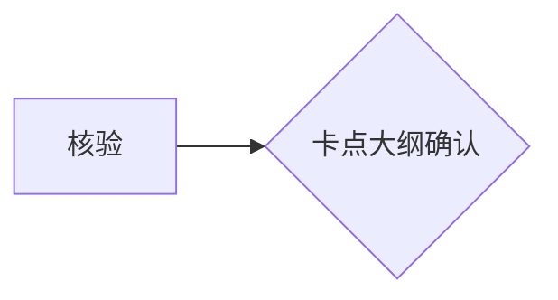
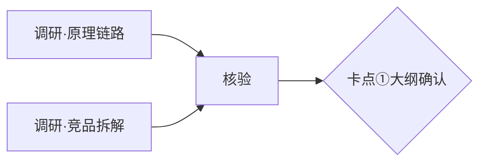

# 字符二分诊断

每一块都是独立的最小复现，互不影响。哪个块渲染成图，就说明它用的字符组合没问题。

把「能渲染的编号」和「报错的编号」一起告诉我即可。

## T1 纯中文标签（无任何符号）

## T2 中文 + 间隔号 `·`

## T3 中文 + 圈号 `①`

## T4 菱形节点 `{}`（纯中文）

## T5 方括号里加双引号（推荐写法，通常最稳）

## T6 完整原版（已知失败，留作对照）

\`\`\`mermaid