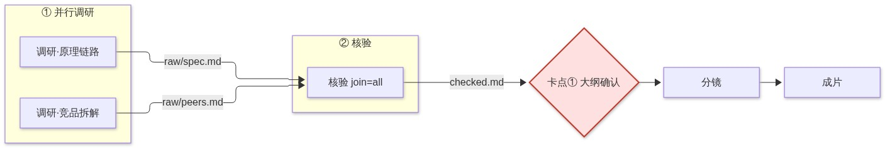
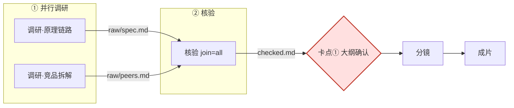
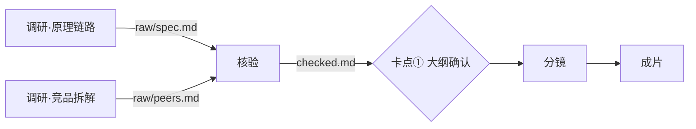
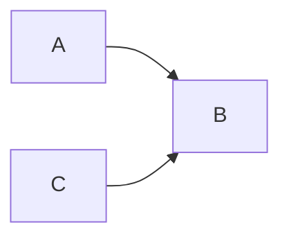
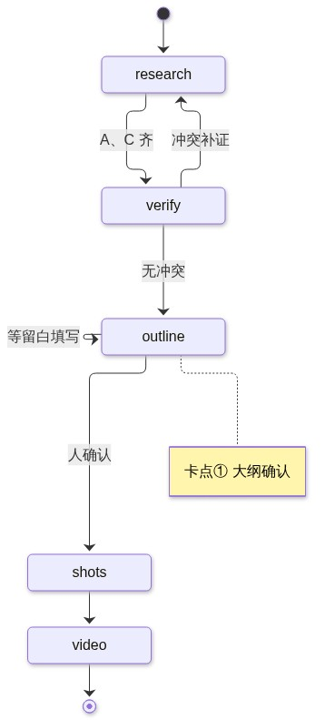
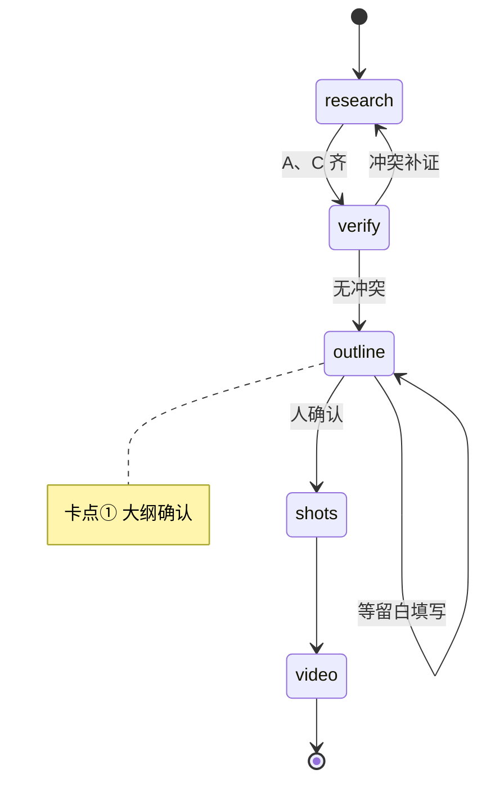
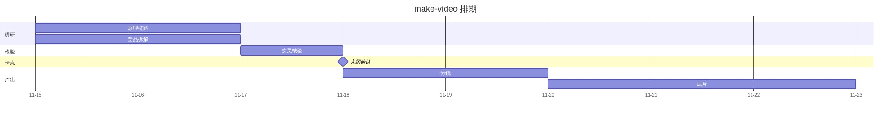
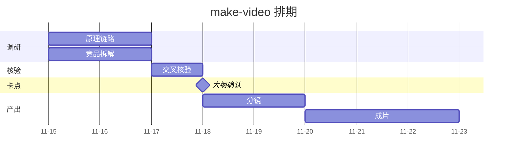

# make-video 工作流（图式计划）

真身是上面的 YAML，下面是它的视图。改结构改 YAML，改依赖看图。

## 1. 主图

上面这张 PNG 就是用它下面这段代码渲染的，**逐字相同**，可以直接复制：

## 2. 兜底：单行版（分号分隔，粘贴丢换行也能过）

与主图同一套依赖与边标签，只是去掉了 subgraph（分组无法挤进单行），并已实测渲染通过：

## 3. 最小诊断块（纯 ASCII，用来判断是不是引擎问题）

如果第 3 块也报错，说明是 Typora 的 mermaid 版本问题，不是语法问题：升级 Typora，或改用 Obsidian（自带较新 mermaid）。

## 4. 合流语义

`C --> B` 和 `A --> B` 同时存在，就是 fan-in：B 必须等 A、C 都交付才启动。对应 YAML 里的 `in: [A, C]` 与 `join: all`。看板/思维导图表达不了这个，因为它们没有"入边集合"这个概念。

## 5. 留白与卡点

`gate: human` 表示停下等人；`blank: [受众, 时长]` 是必须由人填的参数。Agent 执行时读到这两个字段会中断并提问，而不是自己猜。

## 6. 同一份 YAML 的另外两张视图

结构图看依赖，状态机看返工，甘特看排期。三者都从同一份 nodes/edges 推出来，不需要维护两份。

### 6.1 状态机（重跑与回退）

`verify --> research` 这条回边就是截图里那些回环箭头，它说明“核验发现冲突要打回重调”，而不是简单重试。

### 6.2 甘特（排期）

`after a1` 自动把核验排在调研之后，卡点用 `milestone` 标成零宽度节点。
